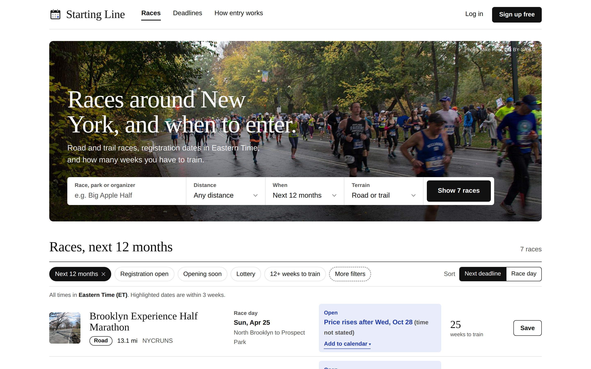
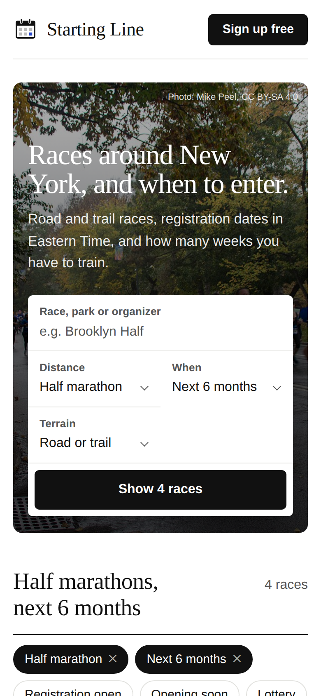
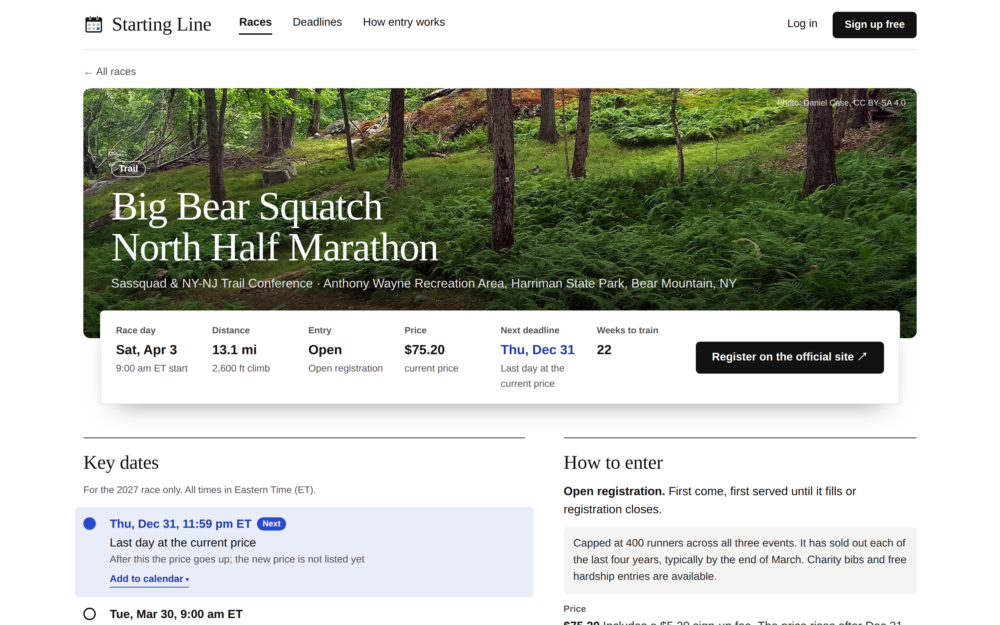
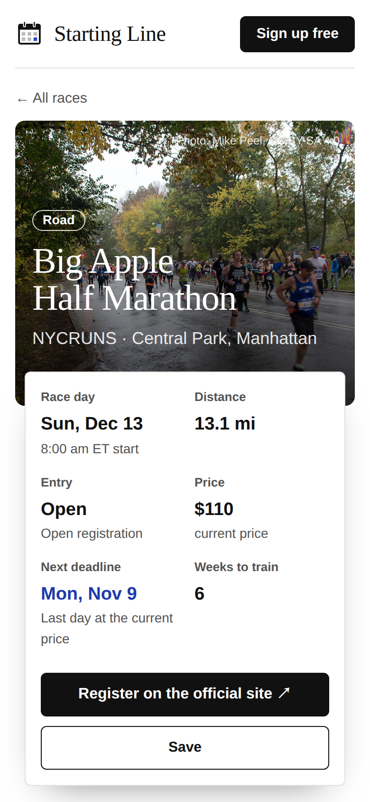
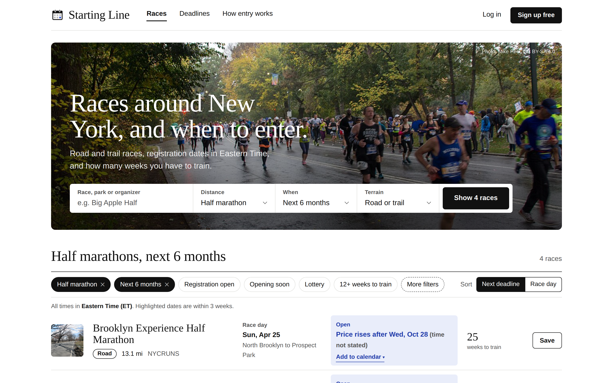
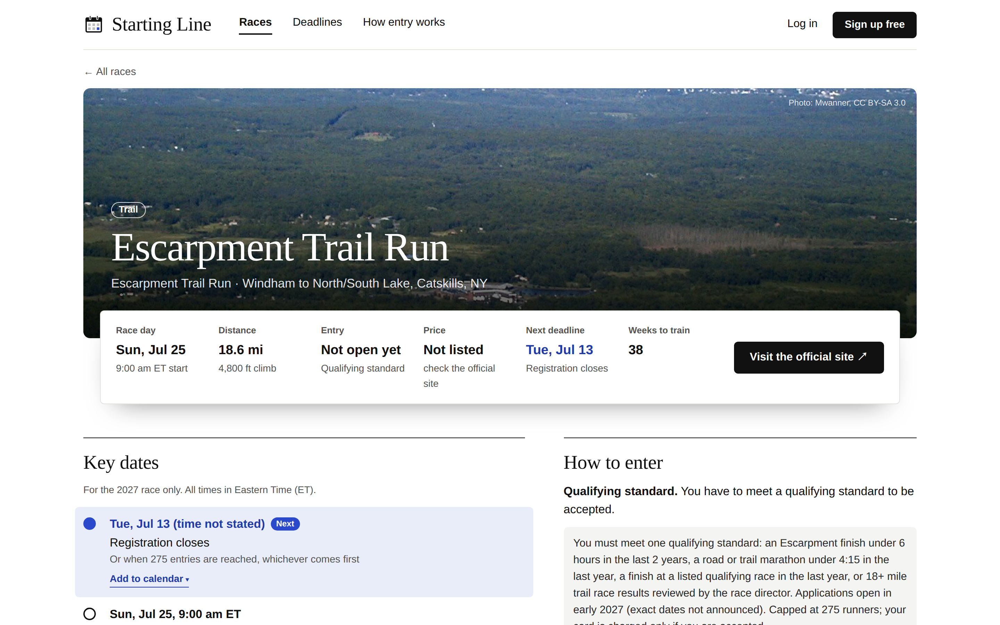
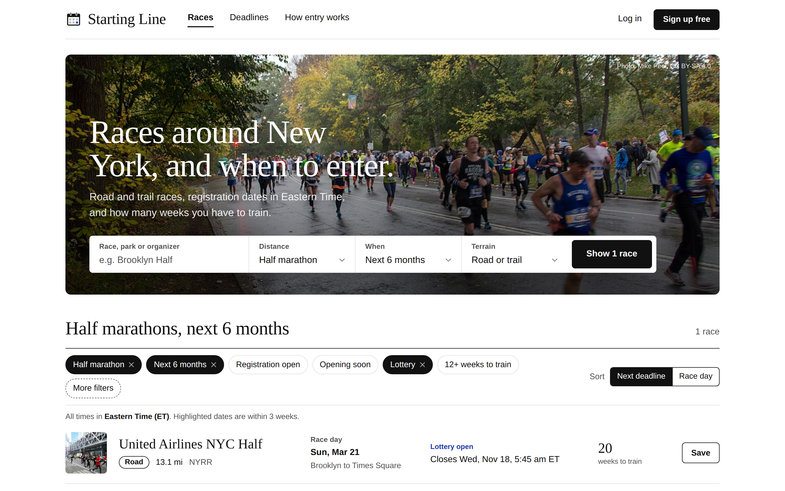
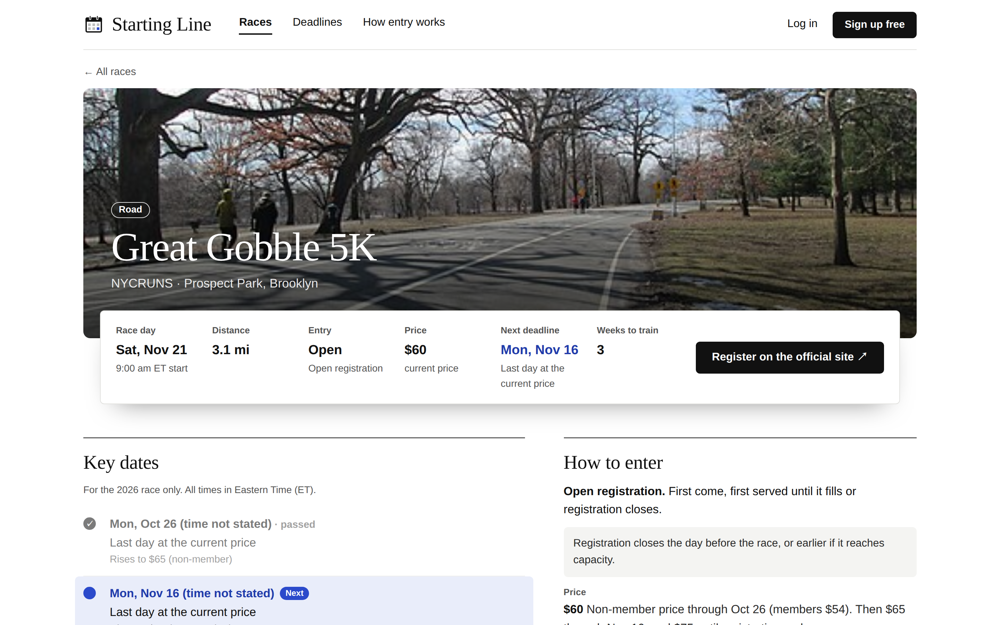

<!-- codeyam:codespaces-starter-readme -->
# Starting Line

Races around New York, and when to enter. A mobile-friendly site for finding
road and trail races in the greater NYC area, with registration dates in
Eastern Time, weeks left to train, and Add to calendar for upcoming
deadlines: one tap to Google Calendar, or an `.ics` download for Apple
Calendar and Outlook. Every race has its own page at `/races/<race>` with how to
enter, the full registration timeline and a link to the official site.

**Status:** the races are real, researched by hand from each organizer's
official page. Every race page shows its source and the date it was last
checked; details we could not confirm are left out, not guessed. Races do not
update automatically, so always check the official site before you register.
Spotted something missing or wrong? Use **Report a missing or wrong detail** on
the race page, which opens a pre-filled issue here. Saving races and accounts
are not live yet.

Photos are from Wikimedia Commons, used under the licences credited in the
site footer.

### Run it

Requires Node.js 20 or newer (`.nvmrc` pins 24).

```bash
npm run setup   # install, create the SQLite database, load the researched races
npm run dev     # http://localhost:3000
```

Race data lives in `prisma/race-data.json`; edit it and run `npm run setup`
again to reload.

- `GET /api/races` returns the filtered race list (same query parameters as the home page).
- `GET /api/races/<slug>/calendar` downloads an `.ics` for the next registration
  date; add `?milestone=<id>` for a specific date or `?event=raceday` for race day.
  Add `target=google` to redirect to Google Calendar's create-event page for the
  same event instead (nothing is sent to Google until the runner taps it).
- `npm test` runs the unit tests.

---

# CodeYam Editor in GitHub Codespaces

[](https://codespaces.new/nseldeib/starting-line-nyc?quickstart=1)

Click the button to try the [CodeYam Editor](https://codeyam.com) with nothing
installed on your own machine. It runs in a GitHub codespace, a Linux machine
GitHub hosts for you and opens in your browser.

## What happens when you click it

GitHub asks for nothing when it creates the codespace: there is no API key to
fill in. You sign in to the AI inside the editor.

1. **The codespace installs everything.** That means the editor, the Claude
   Code CLI, and a browser for screenshots. The first time takes a few minutes.
   A welcome page explains what is happening while you wait.
2. **Wait for the link in the terminal.** When the editor is ready, the
   terminal panel at the bottom of the window shows a boxed "CodeYam Editor is
   ready" with a link. Cmd+click it (Ctrl+click on Windows or Linux).
3. **The editor opens on the New Project screen.** Pick the AI
   that should build, sign in to it, then describe what you want to build. The
   editor builds it with you against a live preview.

This repository is intentionally almost empty: no app, no `.codeyam/`. Your
project is created inside the codespace the first time the editor starts.

## Keeping your work

The button makes a new codespace *from* this template, not one on it, so your
project starts with no repository of its own and this template is never
changed. After your first build, the editor offers to create the project's own
GitHub repository (private by default, under your account). It asks you to
sign in to GitHub once, inside the editor, because the codespace's built-in
token cannot create repositories. The new repository's README gets its own
**Open in GitHub Codespaces** button, which reopens that project.

## Good to know

- **Who can see the editor:** only you. GitHub keeps the editor's port private
  and asks you to sign in to GitHub before it lets anyone through. If you make
  the port public, the editor starts requiring its own one-time token.
- **Stopping and restarting:** your files are kept, and the editor comes back
  on the same address when the codespace restarts.
- **Signing in to Claude:** the editor shows a link. Open it, approve access,
  and paste the code it gives you back into the editor. A rebuilt codespace
  asks you to sign in again; a stopped and restarted one does not.
- **Using Codex, Gemini or OpenCode instead:** pick it in the editor and paste
  its API key there. The key is saved with your project. If you already keep
  it as a Codespaces secret (`OPENAI_API_KEY`, `GEMINI_API_KEY` or
  `OPENCODE_API_KEY` under GitHub's **Settings → Codespaces → Secrets**, with
  access to this codespace's repository), the editor uses it and skips that
  step.

## How this template is made

The files in `.devcontainer/` (`devcontainer.json`, the welcome page
`codeyam-welcome.md`, and `codeyam-ready.sh`, which prints the editor's link)
are generated by
`codeyam-editor editor devcontainer-setup` run in an empty directory. They are
not written by hand, so they match what existing projects get. The editor
repository runs a drift check against them. To regenerate them, run
`codeyam-editor editor starter-refresh --apply` in a checkout of this
repository and commit `.devcontainer/`.

The codespace installs the editor from npm at the production `latest` tag. To
try unreleased builds, use
[`codeyam-ai/codespaces-starter-staging`](https://github.com/codeyam-ai/codespaces-starter-staging),
which is the same template rendered with `--channel staging`.

<!-- codeyam:run-and-edit:start d=b024ecdd083c -->
## Develop this project with codeyam-editor

This project is built with [codeyam-editor](https://codeyam.com) — code and runnable data scenarios are authored side by side against a live preview.

```bash
# Clone the repo
git clone https://github.com/nseldeib/starting-line-nyc && cd starting-line-nyc

# Install codeyam-editor
npm install -g @codeyam-editor/codeyam-editor@latest

# Launch the editor (split-screen terminal + live preview)
codeyam-editor start
```
<!-- codeyam:run-and-edit:end -->

<!-- codeyam:scenario-gallery:start d=295debe4c8f2 -->
## Scenario gallery

States captured as runnable scenarios with codeyam-editor:

### Home - All Distances Next 12 Months



Every distance over the next year on the real researched races, sorted by next deadline: 5K, 10K, halves and the Escarpment 30K, whose qualifier applications are not open yet.

### Home - Phone Layout



The default search on a phone: the hero search stacks into two columns, the nav collapses, and each race row folds under its thumbnail with Save beside the name.

### Race - Big Bear Squatch North



A trail race with exact deadline times: the price-rise and charity-bib dates in ET, a sell-out warning in How to enter, and the organizer's registration link and source.

### Race - Phone Layout



The Big Apple Half on a phone: photo, facts and the key-dates timeline stack in one column with Add to calendar under each date.

### Home - Half Marathons Next 6 Months



The default search (half marathons, next 6 months) on the real researched races, sorted by next deadline: upcoming price rises and registration closings in Eastern Time, with the nearest highlighted.

### Race - Escarpment Trail Run



A qualifier-only race whose applications are not open yet: the qualifying standards, no listed price, and Visit the official site instead of a registration link.

### Home - Lottery Races Only



The Lottery chip switched on: none of the verified races uses a lottery entry, so the results show the no-matches state with a way back to all races.

### Race - Great Gobble 5K



A road race with a park photo and several date-only price rises marked time not stated, each with its own Add to calendar.
<!-- codeyam:scenario-gallery:end -->
