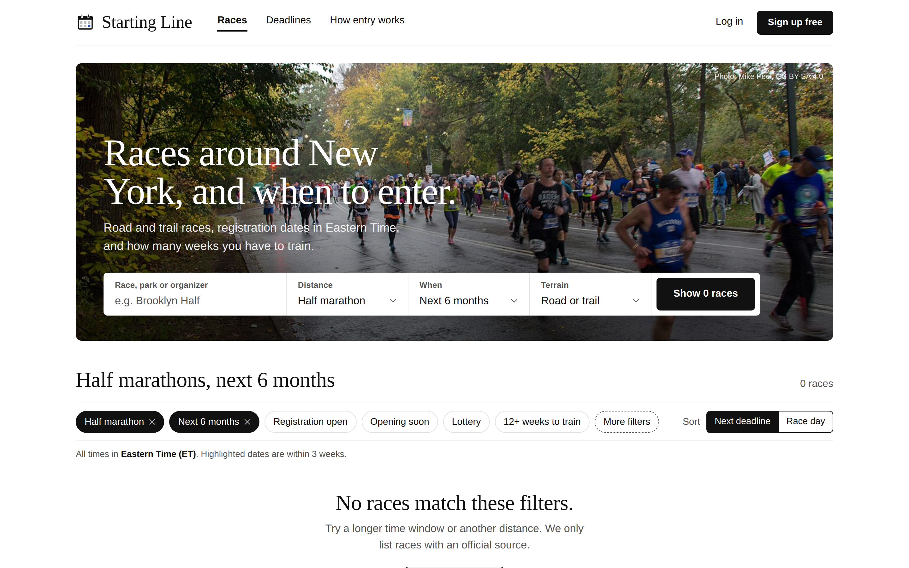

<!-- codeyam:codespaces-starter-readme -->
# Starting Line

Races around New York, and when to enter. A mobile-friendly site for finding
road and trail races in the greater NYC area, with registration dates in
Eastern Time, weeks left to train, and downloadable calendar events for
upcoming deadlines.

**Status:** the race list shown is clearly labelled **sample data**, not
verified race information. Saving races and accounts are not live yet.

### Run it

Requires Node.js 20 or newer.

```bash
npm run setup   # install, create the SQLite database, load the sample races
npm run dev     # http://localhost:3000
```

- `GET /api/races` returns the filtered race list (same query parameters as the home page).
- `GET /api/races/<slug>/calendar` downloads an `.ics` for the next registration
  date; add `?event=raceday` for race day.
- `npm test` runs the unit tests.

---

# CodeYam Editor in GitHub Codespaces

[](https://github.com/codespaces/new?template_repository=codeyam-ai/codespaces-starter)

Click the button to try the [CodeYam Editor](https://codeyam.com) with nothing
installed on your own machine. It runs in a GitHub codespace, a Linux machine
GitHub hosts for you and opens in your browser.

## What happens when you click it

GitHub asks for nothing when it creates the codespace: there is no API key to
fill in. You sign in to the AI inside the editor.

1. **The codespace installs everything.** That means the editor, the Claude
   Code CLI, and a browser for screenshots. The first time takes a few minutes.
   A welcome page explains what is happening while you wait.
2. **Wait for the link in the terminal.** When the editor is ready, the
   terminal panel at the bottom of the window shows a boxed "CodeYam Editor is
   ready" with a link. Cmd+click it (Ctrl+click on Windows or Linux).
3. **The editor opens on the New Project screen.** Pick the AI
   that should build, sign in to it, then describe what you want to build. The
   editor builds it with you against a live preview.

This repository is intentionally almost empty: no app, no `.codeyam/`. Your
project is created inside the codespace the first time the editor starts.

## Keeping your work

The button makes a new codespace *from* this template, not one on it, so your
project starts with no repository of its own and this template is never
changed. After your first build, the editor offers to create the project's own
GitHub repository (private by default, under your account). It asks you to
sign in to GitHub once, inside the editor, because the codespace's built-in
token cannot create repositories. The new repository's README gets its own
**Open in GitHub Codespaces** button, which reopens that project.

## Good to know

- **Who can see the editor:** only you. GitHub keeps the editor's port private
  and asks you to sign in to GitHub before it lets anyone through. If you make
  the port public, the editor starts requiring its own one-time token.
- **Stopping and restarting:** your files are kept, and the editor comes back
  on the same address when the codespace restarts.
- **Signing in to Claude:** the editor shows a link. Open it, approve access,
  and paste the code it gives you back into the editor. A rebuilt codespace
  asks you to sign in again; a stopped and restarted one does not.
- **Using Codex, Gemini or OpenCode instead:** pick it in the editor and paste
  its API key there. The key is saved with your project. If you already keep
  it as a Codespaces secret (`OPENAI_API_KEY`, `GEMINI_API_KEY` or
  `OPENCODE_API_KEY` under GitHub's **Settings → Codespaces → Secrets**, with
  access to this codespace's repository), the editor uses it and skips that
  step.

## How this template is made

The files in `.devcontainer/` (`devcontainer.json`, the welcome page
`codeyam-welcome.md`, and `codeyam-ready.sh`, which prints the editor's link)
are generated by
`codeyam-editor editor devcontainer-setup` run in an empty directory. They are
not written by hand, so they match what existing projects get. The editor
repository runs a drift check against them. To regenerate them, run
`codeyam-editor editor starter-refresh --apply` in a checkout of this
repository and commit `.devcontainer/`.

The codespace installs the editor from npm at the production `latest` tag. To
try unreleased builds, use
[`codeyam-ai/codespaces-starter-staging`](https://github.com/codeyam-ai/codespaces-starter-staging),
which is the same template rendered with `--channel staging`.

<!-- codeyam:run-and-edit:start d=4c81b85f4849 -->
## Develop this project with codeyam-editor

This project is built with [codeyam-editor](https://codeyam.com) — code and runnable data scenarios are authored side by side against a live preview.

```bash
# Install codeyam-editor
npm install -g @codeyam-editor/codeyam-editor@latest

# Launch the editor (split-screen terminal + live preview)
codeyam-editor start
```
<!-- codeyam:run-and-edit:end -->

<!-- codeyam:scenario-gallery:start d=708ec2821af9 -->
## Scenario gallery

States captured as runnable scenarios with codeyam-editor:

### Home - All Distances Next 12 Months


Every distance over the next year, sorted by next deadline: a 15K and a trail 50K join the halves, and the Brooklyn Half sits last with its registration date not yet announced and a tentative race day.

### Home - Phone Layout


The default search on a phone: the hero search stacks into two columns, the nav collapses, and each race row folds under its thumbnail with Save beside the name.

### Home - Half Marathons Next 6 Months


Signed-out home page with the default search (half marathons, next 6 months): four sample races sorted by next registration deadline, the Manhattan Half highlighted with Add to calendar.

### Home - Lottery Races Only


The Lottery chip switched on, narrowing the half marathons to the single lottery-entry race, the NYC Half.

### Home - No Races Listed



The home page before any races are listed: the search and filters still render and the results show the empty state with a Show all races link.
<!-- codeyam:scenario-gallery:end -->
